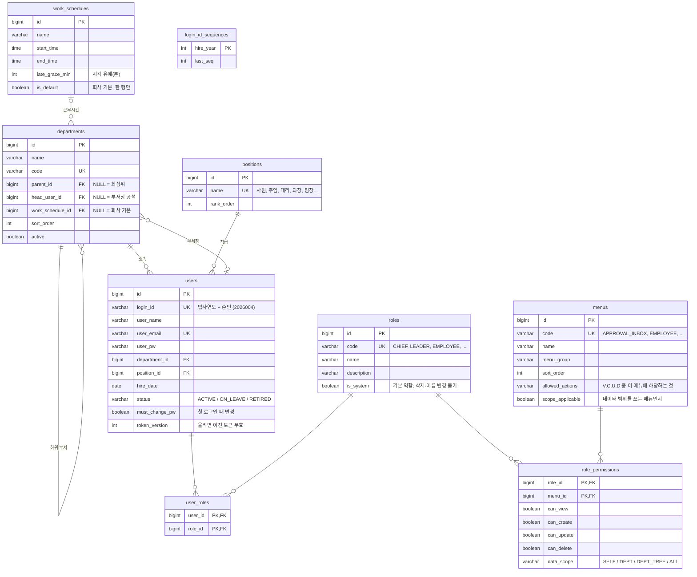
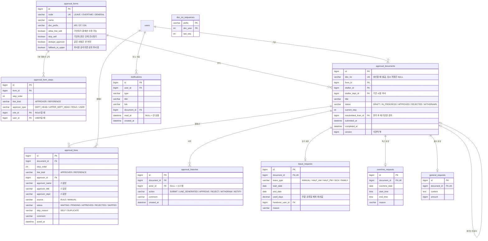
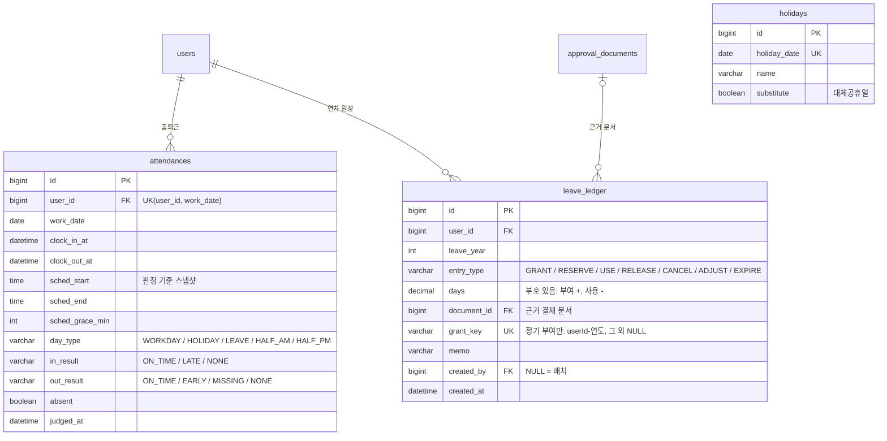

# ERD v2 (목표안 · 초안)

> 상태: 1차 확정 (2026-10-12) · 범위: M1(조직·권한) ~ M3(근태·휴가) · 아키텍처: [11-architecture.md](11-architecture.md)
> DB: MariaDB 10.11 · 기존 테이블은 이름과 컬럼을 되도록 유지하고, 바꾸는 곳은 Flyway 마이그레이션으로 데이터를 옮깁니다.
> 화면 시안: WorkFlow 1차 화면 시안(캔버스) — 결재함, 결재 문서, 기안하기, 결재 양식, 부서, 사원, 역할·권한, 월간 근태표, 내 연차, 홈, 프로젝트 보드

---

## 0. 지금 구조의 문제와 바뀌는 것

| 지금 | 문제 | 바뀌는 것 |
|---|---|---|
| `users.department_code` ('01'~'03' 고정 enum) | 부서를 추가할 수 없고, 상하 관계·부서장이 없음 | `departments` 트리 |
| `users.user_role` (USER/TEAM_LEADER/ADMIN 하나) | 역할을 만들 수 없고, 메뉴·데이터 범위 권한이 없음 | `roles`, `user_roles`, `role_permissions` |
| `users.total/used/remaining_annual_leave` | 세 숫자를 따로 고쳐서 서로 어긋날 수 있고, 언제 왜 바뀌었는지 이력이 없음 | `leave_ledger` (쌓기만 하는 원장, 잔여 = 합계) |
| `leave_requests.approver_id`, `overtime_requests.approver_id` | 결재자가 한 명뿐이고, 결재 상태가 신청 테이블마다 따로 있음 | `approval_documents` + `approval_lines` |
| `attendances.att_status` (NORMAL/LATE/ABSENT) | 조퇴·퇴근 누락을 구분 못 하고, 무엇을 기준으로 판정했는지 남지 않음 | 출근·퇴근 판정 분리 + 판정 기준 스냅샷 |
| (없음) | 공휴일을 모르고 연차 일수를 계산 | `holidays` |

---

## 1. 조직·권한 (M1)

### 설계 메모
- **부서 트리는 `parent_id` 하나로** 저장하고, 하위 부서 전체는 `WITH RECURSIVE`로 조회합니다.
  - 버린 방법: 클로저 테이블, 중첩 집합. 부서가 수십 개이고 이동도 드물어서 얻는 것보다 관리 비용이 큽니다. 하위 부서 조회가 실제로 느려지면 그때 측정하고 바꿉니다.
  - 부서를 옮길 때, 옮길 대상(새 상위 부서)이 자기 하위 부서이면 막습니다(순환 방지).
- **부서장은 `departments.head_user_id`**. 사용자 쪽에 "부서장 여부" 표시를 두면 한 부서에 부서장이 두 명이 될 수 있어서 부서 쪽에 둡니다.
- **아이디 발급은 `login_id_sequences` 행을 잠그고(`SELECT ... FOR UPDATE`) 번호를 올립니다.**
  - 버린 방법: `MAX(login_id) + 1` — 두 명을 동시에 등록하면 같은 번호가 나옵니다. AUTO_INCREMENT — 연도가 바뀔 때 번호를 1부터 다시 시작할 수 없습니다.
- **로그인 즉시 차단은 `users.token_version`**. JWT에 버전을 넣고, 요청마다 DB의 버전과 비교합니다. 퇴사·휴직 처리, 비밀번호 변경 때 버전을 올리면 이전 토큰이 바로 막힙니다. (역할·권한 변경은 권한을 요청마다 조회하므로 버전을 올리지 않아도 바로 반영됩니다.)
  - 버린 방법: Redis 블랙리스트. 서버 한 대, 회사 하나라서 요청마다 PK 조회 한 번이면 충분하고, 저장소를 하나 더 운영할 이유가 없습니다.
- **권한 검사**: API마다 "메뉴 코드 + 동작"을 선언하고, 데이터 범위는 **조회 쿼리 조건으로** 바꿉니다.
  - SELF → 본인 것만, DEPT → 내 부서, DEPT_TREE → 내 부서와 하위 부서(재귀 CTE), ALL → 조건 없음.
  - 역할이 여러 개이면 가장 넓은 범위를 씁니다.
- 회원가입 API는 없앱니다. 사원은 관리자가 등록합니다.

### 기존 데이터 이관
- `department_code` '01'/'02'/'03' → `departments` 3행 (최상위 회사 아래)
- `user_role` → `user_roles` (USER → EMPLOYEE, TEAM_LEADER → LEADER, ADMIN → CHIEF)
- `position_name` → `positions` · `is_active` → `status`

---

## 2. 전자결재 (M2)

### 설계 메모
- **문서 공통 테이블 + 양식별 본문 테이블(1:1)**.
  - 버린 방법 ①: 한 테이블에 모든 양식 컬럼을 넣기 — 양식이 늘 때마다 NULL 컬럼이 늘어납니다.
  - 버린 방법 ②: 본문을 JSON 한 칸에 넣기 — 휴가 기간으로 검색하거나 중복 신청을 검사하는 쿼리를 걸 수 없습니다.
- **결재선은 상신하는 순간 규칙을 풀어서 사람으로 고정**하고, 이름·직급·부서도 함께 저장(스냅샷)합니다. 상신한 뒤 조직이 바뀌어도 진행 중인 문서의 결재자는 바뀌면 안 됩니다.
- **결재함 "내 차례" 조회** = `approval_lines WHERE approver_id = ? AND status = 'PENDING'` → 인덱스 `(approver_id, status, document_id)`.
- **승인·반려 동시 처리** (M0에서 미룬 문제): `UPDATE approval_lines SET status = 'APPROVED' WHERE id = ? AND status = 'PENDING'`의 영향 행이 1일 때만 성공으로 보고, 문서는 `version`으로 한 번 더 막습니다. 늦게 온 요청은 409.
- **회수**: 아무도 승인하지 않았을 때만 가능합니다.
- **반려 후 재기안**은 새 문서로 만들고 `resubmitted_from_id`로 원문서를 가리킵니다. 반려된 문서는 기록으로 그대로 둡니다.
- **문서번호**: `doc_no_sequences` 행 잠금 (아이디 발급과 같은 방식).
- **알림**은 결재 처리와 같은 트랜잭션에서 `notifications` 행으로 저장합니다. 메일처럼 밖으로 나가는 것은 커밋 뒤에 보냅니다(메일 실패가 결재를 되돌리지 않게).

### 기존 데이터 이관
- `leave_requests`, `overtime_requests` 각 행 → `approval_documents` 1건 + 기존 `approver_id`로 `approval_lines` 1줄
- 상태 매핑: PENDING → IN_PROGRESS, APPROVED → APPROVED, REJECTED → REJECTED, CANCELLED → WITHDRAWN
- 이관 후 두 테이블의 `approver_id`, 상태 컬럼 삭제

---

## 3. 근태·휴가 (M3)

> 2026-10-15 변경: `leave_ledger`(연차 원장)와 v1 연차 숫자 이관은 **M2로 앞당김**. 휴가 결재 처리기(상신 때 예약, 승인 때 차감)를 두 번 만들지 않기 위해서입니다. M3에는 출퇴근 판정, 결근 배치, 월간 근태표, 연차 자동 부여 배치가 남습니다. `holidays`는 M1에서 이미 만들었습니다.

### 설계 메모
- **판정 기준을 출근 기록에 함께 저장**합니다. 나중에 부서 근무시간이 바뀌어도 지난 판정이 바뀌지 않습니다.
- **결근은 출근 시점에 알 수 없으므로**, 매일 00:10 배치가 전날 근무일에 기록이 없는 사람에게 결근 행을 만듭니다. 승인된 휴가가 있으면 `day_type = LEAVE`. `UK(user_id, work_date)`가 있어서 배치를 두 번 돌려도 중복 행이 생기지 않습니다.
- **월간 근태표** = 날짜 목록(재귀 CTE) × 부서 사원 → `attendances` LEFT JOIN. 쿼리 하나로 가져오고 `EXPLAIN`으로 `UK(user_id, work_date)` 인덱스를 타는지 확인합니다.
- **연차 원장은 쌓기만 합니다.** 잔여 = `SUM(days) WHERE user_id = ? AND leave_year = ?`.
  - 상신 → RESERVE(−) · 승인 → USE(−) + RELEASE(+) · 반려·회수 → RELEASE(+) · 승인 후 취소 → CANCEL(+)
  - 사람당 한 해 수십 행이라 SUM으로 충분합니다. 느려지면 그때 측정하고 요약 테이블을 둡니다.
- **잔여 초과 동시 신청**: 같은 사람이 두 건을 동시에 상신해서 잔여를 넘기는 경우를 막으려고, 상신 트랜잭션에서 그 사용자 행을 잠근(`SELECT ... FOR UPDATE`) 뒤 잔여를 계산합니다.
- **연차 자동 부여 배치**: `grant_key` 유니크 제약 때문에 두 번 실행해도 한 번만 부여됩니다. (MariaDB는 UNIQUE 컬럼에 NULL이 여러 개 들어갈 수 있어서 정기 부여 외의 행은 NULL로 둡니다.)
- (2026-10-24, M3 명세에서 추가) `attendances.fix_document_id`(근태 정정 결재 문서), `attendance_fix_requests`(정정 양식 본문, 정정 전 값 `before_json`), `batch_runs`(배치 실행 기록). 연도별 원장이라 `EXPIRE` 행은 쓰지 않습니다(전년도 잔여는 그 해 원장에 남고 넘어오지 않음). 자세한 규칙은 [14-rest-api-v2-m3.md](14-rest-api-v2-m3.md).

### 기존 데이터 이관
- `users.total_annual_leave` → GRANT 행, `users.used_annual_leave` → USE 행 (memo: "v1 이관")
- 이관 후 `users`의 연차 숫자 세 컬럼 삭제

---

## 4. 그대로 두는 테이블
`projects`, `project_members`, `tasks`, `task_assignments` — 구조는 유지합니다. M4(프로젝트 보드)에서 `tasks`에 보드 안 순서 컬럼 추가 정도만 검토합니다.

---

## 5. 결정 (2026-10-12 확정)

| # | 질문 | 결정 | 버린 선택지 |
|---|---|---|---|
| 1 | 승인 때 원장을 어떻게 남기나 | USE(−) + RELEASE(+) 두 줄 추가 (쌓기만 유지) | RESERVE 줄을 USE로 수정 — "고치지 않는다" 원칙이 깨짐 |
| 2 | 반려 후 다시 올릴 때 | 새 문서 + `resubmitted_from_id`로 원문서 연결 | 같은 문서를 다시 진행 — 이력이 섞임 |
| 3 | 역할이 여러 개일 때 데이터 범위 | 가장 넓은 범위 | 메뉴마다 따로 지정 — 설정이 복잡해짐 |
| 4 | 부서 트리 저장 방식 | parent_id + 재귀 CTE | 클로저 테이블 — 이 규모에선 관리 비용이 큼 |
| 5 | 로그인 즉시 차단 | token_version을 DB와 비교 | Redis 블랙리스트 — 저장소를 하나 더 운영할 이유가 없음 |
| 6 | 첨부 파일 | 1차에서 제외 (품의 화면은 자리만) | 1차에 포함 — 파일 저장소 결정이 필요해 범위가 커짐 |
