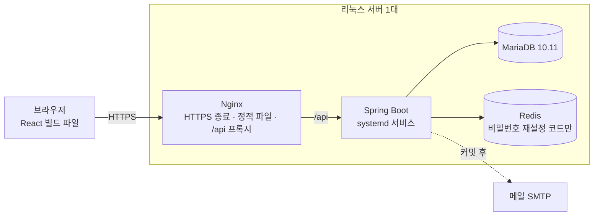
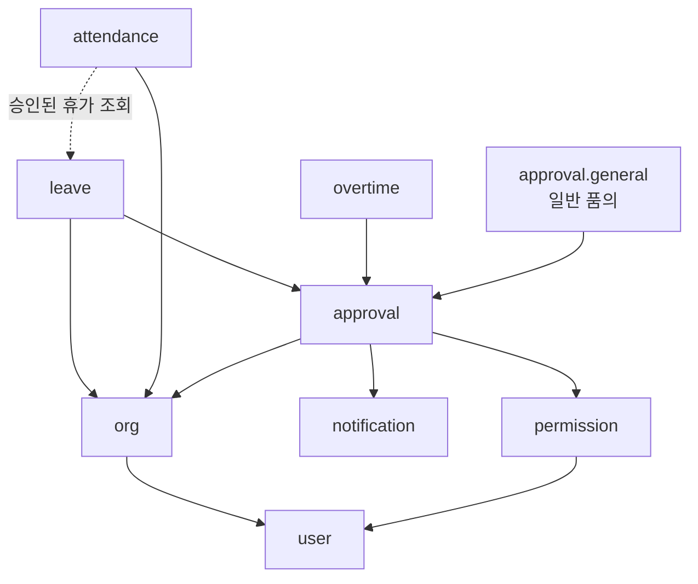

# 아키텍처 v2

> 상태: 1차 확정 (2026-10-12) · 범위: M1 ~ M5 · ERD: [10-erd-v2.md](10-erd-v2.md)

## 1. 한 줄 요약

회사 하나에 설치하는 그룹웨어입니다. **서버 한 대에서 도는 모놀리스**이고, 도메인별 패키지로 경계를 나눕니다. 공통 결재와 업무(휴가·특근·품의)는 **양식 처리기 인터페이스**로 연결합니다.

---

## 2. 시스템 구성



| 결정 | 고른 것 | 버린 것과 이유 |
|---|---|---|
| 서비스 구조 | 모놀리스 | MSA — 승인과 연차 차감은 반드시 한 트랜잭션이어야 하는데, 서비스를 나누면 분산 트랜잭션이나 보상 처리가 필요해집니다. 사용자 수백 명, 회사 하나 규모에서 얻는 것이 없습니다. |
| 앞단 | Nginx | Spring Boot가 정적 파일까지 서빙 — 프론트와 백엔드 배포가 묶이고, HTTPS 설정을 앱이 떠안게 됩니다. |
| Redis 범위 | 이미 구현된 비밀번호 재설정 코드(만료 시간)만 | 토큰 차단·캐시로 범위를 넓히기 — 지금 규모에선 DB로 충분합니다. 범위를 넓히지 않습니다. |
| 배포 방식 | jar + systemd 직접 운영 | Docker Compose — 리눅스 운영(서비스 등록, 로그, 백업)을 직접 다루는 것이 목표라서 직접 운영합니다. Docker는 테스트(Testcontainers)에만 씁니다. |

---

## 3. 패키지 구조와 의존 방향

```
com.minierp.backend
├── global        공통 응답·예외·JWT 필터·권한 검사(@RequirePermission, DataScope)
├── user          사원 계정, 로그인, 비밀번호 재설정            (기존)
├── org           부서 트리, 직급, 근무시간, 공휴일              (신규)
├── permission    역할, 메뉴, 역할별 권한                        (신규)
├── approval      결재 문서, 결재선, 양식 규칙, 결재함, 처리기 인터페이스 (기존 패키지 재구성)
├── leave         휴가 본문, 연차 원장, 연차 자동 부여           (approval 안의 Leave* 를 옮김)
├── overtime      특근 본문                                      (기존)
├── attendance    출퇴근, 판정, 결근 배치, 월간 근태표           (기존)
├── notification  알림                                           (신규)
└── project · task · dashboard · calendar                        (기존 유지)
```



**규칙**
- `approval`은 `leave`, `overtime`을 **모릅니다**. 처리기 인터페이스만 정의하고, 업무 쪽이 구현합니다. (4장)
- 공휴일·근무시간은 휴가 일수 계산과 근태 판정 둘 다 쓰므로 바닥 모듈인 `org`에 둡니다.
- 순환 의존은 금지합니다. 글로만 두면 깨지므로, 테스트로 의존 규칙을 검사하는 것을 권장합니다(ArchUnit, 테스트 전용 라이브러리 — 추가할 때 이유를 기록).

---

## 4. 결재와 업무를 잇는 방법 (핵심 결정)

```java
// approval 패키지에 정의, 업무 모듈이 구현
public interface ApprovalFormHandler {
    String formCode();                        // "LEAVE", "OVERTIME", "GENERAL"
    void validate(ApprovalDraft draft);       // 상신 전 검사: 잔여 연차, 기간 중복, 시간 순서
    void onSubmitted(ApprovalDocument doc);   // 휴가: 연차 RESERVE(−)
    void onApproved(ApprovalDocument doc);    // 최종 승인: 휴가 USE(−) + RELEASE(+)
    void onRejected(ApprovalDocument doc);    // 휴가: RELEASE(+)
    void onWithdrawn(ApprovalDocument doc);   // 휴가: RELEASE(+)
}
```

`ApprovalService`는 양식 코드로 처리기를 찾아(스프링이 구현체 목록을 주입) **같은 트랜잭션 안에서 동기로** 부릅니다.

| 선택지 | 내용 | 판단 |
|---|---|---|
| A. 직접 호출 | 결재 서비스가 휴가·특근 서비스를 직접 부름 | 버림 — 양식이 늘 때마다 결재 코드를 고쳐야 합니다. |
| **B. 처리기 인터페이스** | 결재는 인터페이스만 알고, 양식마다 구현 | **채택** — 양식 추가 = 구현체 추가. 같은 트랜잭션이라 승인과 연차 차감이 함께 커밋·롤백됩니다. |
| C. 이벤트 | 결재가 "승인됨" 이벤트를 발행, 업무 모듈이 구독 | 버림 — 흐름을 코드로 따라가기 어렵고, 같은 트랜잭션을 보장하려면 결국 동기 리스너로 묶어야 해서 B와 차이가 없습니다. |

---

## 5. 트랜잭션 경계

| 동작 | 한 트랜잭션 안 | 커밋 뒤 |
|---|---|---|
| 상신 | 사용자 행 잠금 → `validate` → 문서번호 발급 → 결재선 생성(규칙 해석·스냅샷) → `onSubmitted` → 이력 → 알림 행 | 메일 |
| 중간 승인 | 내 결재선 조건부 UPDATE → 다음 결재자 PENDING → 이력 → 알림 행 | 메일 |
| 최종 승인 | 위와 같음 + 문서 APPROVED + `onApproved` | 메일 |
| 반려 · 회수 | 결재선·문서 상태 변경 + `onRejected` / `onWithdrawn` + 이력 + 알림 행 | 메일 |

- 메일은 `@TransactionalEventListener(phase = AFTER_COMMIT)`로 보냅니다. 메일이 실패해도 결재는 되돌리지 않고 로그만 남깁니다.
- **잠금 순서를 고정**합니다: 사용자 행 → 번호 발급 행 → 문서 행. 순서가 섞이면 교착 상태가 생길 수 있습니다.
- 문서번호 발급 행(양식·연도별 한 행)은 커밋까지 잠겨 있으므로, 같은 양식 상신은 한 줄로 처리됩니다. 이 규모에선 문제없고, 느려지면 측정한 뒤 발급만 별도 트랜잭션으로 뺍니다(빈 번호가 생길 수 있는 대가).

---

## 6. 권한 처리 위치

| 단계 | 어디서 | 방법 |
|---|---|---|
| 인증 | `JwtAuthenticationFilter` (기존) | 서명 검증 + 토큰의 버전과 `users.token_version` 비교 → 다르면 401 |
| 메뉴·동작 권한 | 컨트롤러 메서드 | `@RequirePermission(menu = "EMPLOYEE", action = CREATE)` → 인터셉터에서 검사 → 403 |
| 데이터 범위 | 서비스 → 리포지토리 | `DataScope`(SELF / DEPT / DEPT_TREE / ALL + 부서 id 목록)를 **쿼리 조건으로** 넘김. 가져온 뒤 자바에서 거르지 않음 |
| 화면 | 프론트 | `GET /api/v1/me/permissions`로 메뉴를 숨기기만 함. 최종 판단은 항상 서버 |

- 권한은 요청마다 한 번 조회합니다(사용자당 수십 행). 느려지면 측정한 뒤 `token_version`을 키로 캐시합니다.

---

## 7. 배치

| 작업 | 언제 | 두 번 실행돼도 안전한 이유 |
|---|---|---|
| 결근 판정 | 매일 00:10 (전날 대상) | `attendances`의 `UK(user_id, work_date)` |
| 연차 정기 부여 | 1월 1일 00:30 | `leave_ledger.grant_key` 유니크 |

- 서버 한 대라서 `@Scheduled`로 충분합니다. 서버가 두 대가 되면 같은 배치가 양쪽에서 돌기 때문에 실행 잠금(예: ShedLock)이 필요합니다. 지금은 쓰지 않고, 대신 위처럼 결과가 중복되지 않게 만들어 둡니다.
- 실행 결과(대상 날짜, 처리 건수, 걸린 시간)는 로그로 남깁니다.

---

## 8. 배포·운영 (M5)

> 세부 결정과 완료 기준은 [16-deploy-ops-m5.md](16-deploy-ops-m5.md) (2026-10-28).

| 항목 | 방법 |
|---|---|
| 앱 실행 | 전용 리눅스 사용자 + systemd 서비스. 비밀값은 `/etc/workflow/env` (권한 600) |
| DB | 로컬 접속만 허용, 앱 전용 계정에 필요한 권한만 |
| Redis | `127.0.0.1`에만 바인딩 |
| 배포 순서 | jar 빌드 → 서버 복사 → `systemctl restart` → 기동 시 Flyway 마이그레이션 → 헬스 체크 |
| 백업 | 매일 `mysqldump --single-transaction` (systemd timer), 7일 보관, 복구 리허설 1회 기록 |
| 로그 | journald + 파일 로테이션, MariaDB 느린 쿼리 로그 켜기(1초) → 쿼리 개선 소재 |
| 헬스 체크 | Spring Boot Actuator의 health만 노출 (추가할 때 이유 기록) |

---

## 9. 결정 목록

| 번호 | 결정 | 근거 위치 |
|---|---|---|
| AD-01 | 서버 한 대 모놀리스 | 2장 |
| AD-02 | 결재 ↔ 업무는 양식 처리기 인터페이스, 같은 트랜잭션 | 4장 |
| AD-03 | 데이터 범위는 쿼리 조건으로 | 6장 |
| AD-04 | 즉시 차단은 `token_version` DB 비교 | 6장, ERD 1장 |
| AD-05 | 아이디·문서번호는 행 잠금으로 발급 | 5장, ERD 1·2장 |
| AD-06 | 연차는 쌓기만 하는 원장 | ERD 3장 |
| AD-07 | 배치는 결과가 중복되지 않게(유니크 키), 실행 잠금은 서버가 늘 때 | 7장 |
| AD-08 | 배포는 jar + systemd 직접 운영 | 2장, 8장 |
